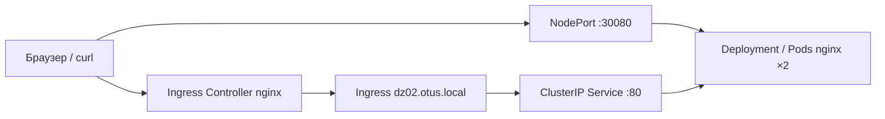

# ДЗ-2 — Сетевая подсистема в Kubernetes

**Статус: подготовлены манифесты, выполнение на реальном кластере не подтверждено.**

Официальное задание OTUS: запустить Minikube с `--cni calico` или `--cni flannel`; создать Nginx Deployment и NodePort; включить расширение ingress и Nginx Ingress Controller; настроить Ingress и проверить доступ из браузера или curl. Для сдачи нужны два доказательства: NodePort и доступ через Ingress.

Источники: материалы занятия OTUS «Сетевая подсистема в Kubernetes», презентация 36 слайдов, преподаватель Андрей Вилков, и текст ДЗ в личном кабинете. В презентации модель сети — с. 8, CNI — с. 16–17, Service — с. 20, NodePort — с. 23, Ingress — с. 27–28, ДЗ — с. 31.

## Лабораторная схема


## Требования к среде
Windows + Docker Desktop + Minikube; учебный профиль `otus-k8s`, контекст `otus-k8s`. **Нельзя** создавать второй кластер поверх повреждённого профиля: сначала восстановить ДЗ-1 и подтвердить Node Ready. Устанавливаем Calico только при создании нового, безопасно пересоздаваемого учебного профиля. Не удалять чужие образы/тома Docker.

## Команды — после успешного запуска Minikube
```powershell
kubectl --context otus-k8s apply -f .\DZ_02\manifests\01-namespace.yaml
kubectl --context otus-k8s apply -f .\DZ_02\manifests\02-deployment.yaml
kubectl --context otus-k8s apply -f .\DZ_02\manifests\03-service-nodeport.yaml
kubectl --context otus-k8s apply -f .\DZ_02\manifests\04-service-clusterip.yaml
kubectl --context otus-k8s -n otus-k8s-dz02 rollout status deployment/network-nginx
kubectl --context otus-k8s -n otus-k8s-dz02 get pods,svc -o wide
minikube addons enable ingress -p otus-k8s
kubectl --context otus-k8s -n ingress-nginx rollout status deployment/ingress-nginx-controller --timeout=300s
kubectl --context otus-k8s apply -f .\DZ_02\manifests\05-ingress.yaml
kubectl --context otus-k8s -n otus-k8s-dz02 get ingress,svc,endpoints
```
`minikube addons enable ingress` устанавливает ingress-nginx controller, отдельная установка для типичного Minikube не требуется. Убедитесь, что Controller Ready.

## Проверка NodePort в Windows с Docker driver
На Windows прямой IP узла Minikube может быть недоступен. Команда `minikube service network-nginx-nodeport -n otus-k8s-dz02 --url -p otus-k8s` может открыть временный локальный туннель; **не закрывайте** его до проверки. Сохраните выданный адрес и проверьте `curl.exe <адрес>` в отдельном окне. Адрес не угадывать.

## Проверка Ingress
В Windows + Docker driver возможна необходимость `minikube tunnel -p otus-k8s` (отдельное окно, могут потребоваться права администратора); проверить реальный IP и контроллер. Затем `curl.exe -H "Host: dz02.otus.local" http://127.0.0.1/` **только если туннель действительно направляет ingress на 127.0.0.1:80**. При иной конфигурации использовать реально установленный адрес/порт. Диагностика: `kubectl --context otus-k8s -n ingress-nginx get pods,svc`, `kubectl --context otus-k8s -n otus-k8s-dz02 describe ingress network-nginx-ingress`. Не подменять доказательство NodePort скриншотом обычного port-forward.

## Security Gate
1. По умолчанию демонстрационный NodePort открыт через узел: не переносить конфигурацию на публичный сервер.
2. Не применять default-deny без анализа трафика: это преднамеренно остановит доступ. Файл `optional-networkpolicy-default-deny.yaml` **не входит** в основную последовательность.
3. Проверить отсутствие лишних публичных портов, права Pod, версию образа, ограничение ресурсов, логи и доступность DNS.
4. Nginx `nginx:1.28` учебный пример. Hardened вариант с непривилегированным контейнером и нужными разрешениями/портом подготовить отдельно; здесь это не реализовано.
5. Сохранить результаты security-аудита, решение по остаточным рискам и журнал исправлений.

## Скриншоты для сдачи
- `01-nodeport.png`: адрес NodePort + успешный ответ Nginx.
- `02-ingress.png`: правило Ingress + успешный HTTP-ответ Nginx с Host.
- `03-security.png` (наша дополнительная проверка): NetworkPolicy и анализ поверхности доступа.

## Ссылки
- [Занятие 3](../LESSONS/03_Kubernetes_Networking/README.md)
- [ДЗ-1](../DZ_01/README.md)
- [Реестр угроз](../SECURITY/threats/devsecops_top100.csv)
