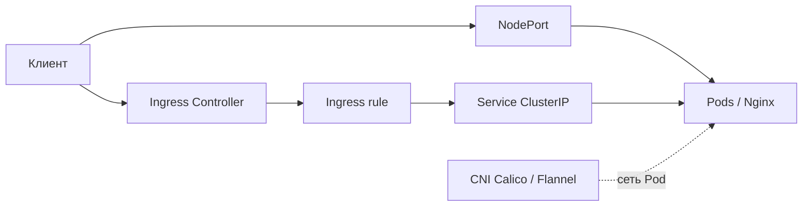

# Занятие 3. Сетевая подсистема в Kubernetes

**Преподаватель:** Андрей Вилков. **Продолжительность:** 90 минут. **Статус:** конспект и ДЗ подготовлены, лаборатория ещё не пройдена.

## Цели (по учебным материалам OTUS)
Разобрать сетевое взаимодействие Pod внутри одной ноды и между нодами; изучить CNI, сервисы Kubernetes и Ingress.

## Модель сети
- Каждому Pod назначается собственный IP-адрес в кластере.
- В сетевой модели Kubernetes Pod разных узлов способны взаимодействовать без NAT между адресами Pod.
- Контейнеры одного Pod делят сетевое пространство имён и localhost.
- CNI управляет настройкой интерфейсов и IP-адресов; в презентации перечислены Calico, Flannel, Cilium, Weave.
- Сервис стабилизирует адресацию и выбор Pod, даже если сами Pod пересоздаются.

## Сервисы и публикация
`ClusterIP` — внутри кластера; `NodePort` — порт на узлах; `LoadBalancer` — сервис с внешним балансировщиком; `Ingress` — маршрутизация HTTP(S), требующая работающего Ingress Controller.

## Архитектурная схема

## Сопоставление с презентацией
| Страницы | Тема |
|---|---|
| 8–12 | Модель сети, network namespace, veth, bridge |
| 15–17 | Связь разных нод, CNI |
| 20–24 | Service, kube-proxy, NodePort и LoadBalancer |
| 27–29 | Ingress, контроллеры |
| 31 | Формулировка ДЗ |

## Проверки безопасности на каждом шаге
- **CNI:** подтвердить фактический плагин, проверить поддержку и действие NetworkPolicy (Flannel сам по себе обычно не обеспечивает политику Kubernetes — требуется совместимое решение).
- **Pod:** права, ServiceAccount, ресурсы, версия образа.
- **NodePort:** не открывать учебный порт в публичную сеть без необходимости.
- **Ingress:** проверить маршрут и Host; в рабочем контуре дополнительно TLS, ограничения доступа и журналирование.
- **NetworkPolicy:** экспериментировать с default-deny только отдельно от базового рабочего задания, затем тестировать разрешённые потоки и отказ запрещённых.

## ДЗ
[Полная инструкция и манифесты ДЗ-2](../../DZ_02/README.md).

## Правило сдачи
Снимок 1 — NodePort реально отвечает. Снимок 2 — HTTP-трафик проходит через Nginx Ingress Controller. Состояние не подтверждено до выполнения на реальном кластере.
