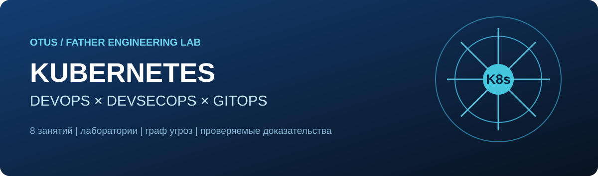
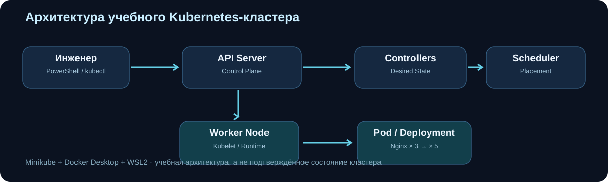
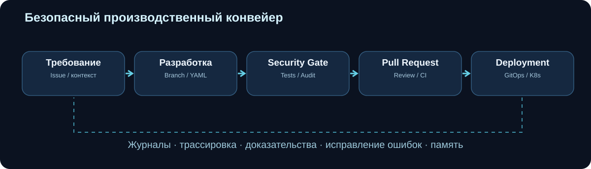
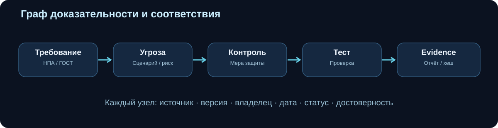
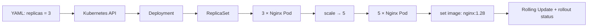
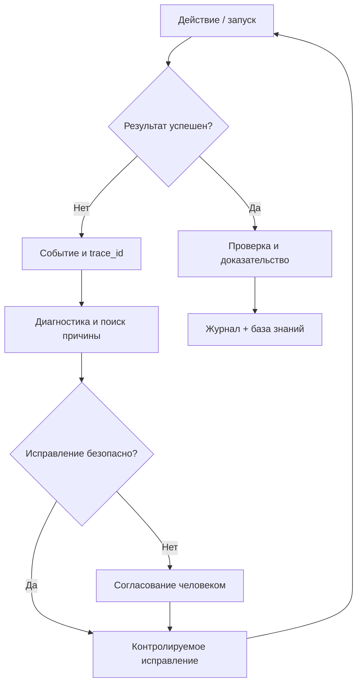

<p align="center"></p>

<h1 align="center">☸️ OTUS Kubernetes · FATHER Engineering Lab</h1>
<p align="center"><strong>От первого Pod до защищённого конвейера разработки с проверяемыми доказательствами.</strong></p>
<p align="center"><a href="#-маршрут-обучения">Уроки</a> · <a href="#-библиотека-схем">Схемы</a> · <a href="#-безопасность-из-первого-урока">DevSecOps</a> · <a href="#-дз-1--nginx">ДЗ-1</a> · <a href="#-справочная-библиотека">Документация</a></p>

> **Состояние проекта.** В репозитории созданы учебные каталоги, YAML-манифесты, реестр из 100 *авторских* сценариев угроз и первоначальный CLI-аудитор. Локальный кластер `otus-k8s` пока не подтверждён как исправный. Полноценная фабрика с кнопками, runtime-трассировкой и автоматическим допуском — **проектируется**, не выдана за работающую систему.

## 🧭 Коротко о проекте

| Контур | Что изучаем и создаём |
|---|---|
| **Kubernetes** | Pod, ReplicaSet, Deployment, сеть, хранилища, ресурсы, Service Mesh и кластер |
| **DevOps / GitOps** | Git, ветки, Pull Request, CI/CD, воспроизводимые сборки и поставка |
| **DevSecOps** | Модель угроз, проверки YAML и образов, управление доступом, журналы и доказательства |
| **FATHER Factory** | Единое рабочее место, справка, граф требований и угроз, история операций и агенты |

**Связанные проекты:** [OTUS AI Architect](https://github.com/VictorKVS/OTUS-) · [FATHER Factory — ветка сайта](https://github.com/VictorKVS/OTUS-/tree/feature/otus-homework-site/factory) · [Программа интеграции курсов](docs/COURSE_INTEGRATION.md).

## 🎓 Маршрут обучения

| № | Занятие | Контроль безопасности |
|---|---|---|
| [01](LESSONS/01_Introduction_to_Kubernetes/README.md) | Введение в Kubernetes: архитектура | API, доступы, конфигурация кластера |
| [02](LESSONS/02_Kubernetes_Objects/README.md) | Объекты в Kubernetes · **ДЗ-1** | Pod Security, права, образы, лимиты |
| [03](LESSONS/03_Kubernetes_Networking/README.md) | Сетевая подсистема · ДЗ | NetworkPolicy, DNS, TLS |
| [04](LESSONS/04_Kubernetes_Storage/README.md) | Хранение данных · ДЗ | Secrets, PV/PVC, шифрование |
| [05](LESSONS/05_Requests_Limits_Load_Balancing/README.md) | Requests, limits, load balancing | Квоты, перегрузка и доступность |
| [06](LESSONS/06_Service_Mesh/README.md) | Архитектура Service Mesh | mTLS, идентичность, политики |
| [07](LESSONS/07_Kubernetes_Cluster_Deployment/README.md) | Развёртывание кластера · ДЗ | Hardening, аудит, CIS |
| [08](LESSONS/08_Git_and_CICD/README.md) | Git и CI/CD | SAST, секреты, зависимости, supply chain |

## 🖼️ Библиотека схем

> Все иллюстрации доступны как **исходные SVG**, пригодные для просмотра на GitHub, включения в сайт и последующего редактирования. Схемы описывают архитектуру и процессы, а не подтверждают фактический запуск.

### 01 · Архитектура кластера


[Открыть исходную SVG-схему](docs/assets/k8s-architecture.svg)

### 02 · DevSecOps — путь изменения до релиза


[Открыть исходную SVG-схему](docs/assets/devsecops-pipeline.svg)

### 03 · Граф требований, угроз, мер защиты и доказательств


[Открыть исходную SVG-схему](docs/assets/evidence-graph.svg)

### 04 · Динамика работы Deployment



### 05 · Как DevSecOps разбирает ошибку



## 🛡️ Безопасность из первого урока

**Единая последовательность:** `Требование → Угроза → Мера защиты → Проверка → Доказательство → Исправление`.

- [Реестр 100 сценариев угроз](SECURITY/threats/devsecops_top100.csv) — авторский рабочий перечень, не официальный «Top-100».
- [Аудитор Kubernetes YAML](SECURITY/agent/audit_k8s.py) — **локальный read-only MVP**, не автономный LLM-агент.
- [Программа DevSecOps и источники](SECURITY/README.md).
- [Карта российских нормативных документов](SECURITY/regulations/RU_REGULATORY_MAP.md).
- [Пул-реквест внедрения GitHub DevSecOps](https://github.com/VictorKVS/OTUS_Kibirnetes/pull/1) — пока на проверке.

## 🧪 ДЗ-1 — Nginx

[Подробное задание](DZ_01/README.md) · [Pod](DZ_01/manifests/pod.yaml) · [Deployment](DZ_01/manifests/deployment.yaml)

| Этап | Ожидаемый результат |
|---|---|
| Запустить Minikube | узел `Ready` |
| Применить Pod Nginx | `Running` |
| Создать Deployment | `3/3` |
| Изменить число реплик | `5/5` |
| Обновить образ | `nginx:1.28`, rollout успешен |
| Подготовить доказательства | скриншоты Pod/Deployment, масштабирования и версии |

**Важно:** исходные манифесты преподавателя и отдельно усиленные конфигурации безопасности не смешиваем. Фактическое прохождение ДЗ подтверждается журналом команд и скриншотами, а не только наличием файлов в Git.

## 📚 Справочная библиотека

| Документ | Для чего |
|---|---|
| [Связь OTUS AI Architect и Kubernetes](docs/COURSE_INTEGRATION.md) | Контекст обучения |
| [Стандарт разработки — по-русски](https://github.com/VictorKVS/OTUS_Kibirnetes/blob/feature/devsecops-github-baseline/docs/ENGINEERING_OPERATING_MODEL.ru.md) | Задача → PR → CI → релиз |
| [Трассировка, память и аудит — по-русски](https://github.com/VictorKVS/OTUS_Kibirnetes/blob/feature/devsecops-github-baseline/docs/FATHER_AUDIT_TRACE_MEMORY_SPEC.ru.md) | Доказательства и история действий |
| [Граф угроз и весов — по-русски](https://github.com/VictorKVS/OTUS_Kibirnetes/blob/feature/devsecops-github-baseline/SECURITY/THREAT_GRAPH_SCHEMA.ru.md) | Узлы, связи и происхождение |
| [Восстановление лаборатории — по-русски](https://github.com/VictorKVS/OTUS_Kibirnetes/blob/feature/devsecops-github-baseline/docs/LOCAL_RECOVERY_AND_SYNC.ru.md) | Minikube и Git |
| [Интерфейс FATHER Factory — по-русски](https://github.com/VictorKVS/OTUS-/blob/feature/otus-homework-site/factory/docs/ENGINEERING_AUDIT_UI_CONTRACT.ru.md) | Кнопки, справка, ошибки, аудит |

**Официальные опорные материалы:** [Kubernetes Documentation](https://kubernetes.io/docs/home/) · [OWASP Kubernetes Top 10](https://owasp.github.io/www-project-kubernetes-top-ten/) · [MITRE ATT&CK Containers](https://attack.mitre.org/matrices/enterprise/containers/) · [NIST SP 800-190](https://csrc.nist.gov/pubs/sp/800/190/final).

## 🏗️ Структура

```text
OTUS_Kibirnetes/
├── LESSONS/                # 8 занятий
├── DZ_01/                  # первое домашнее задание и YAML
├── SECURITY/               # угрозы, нормативные источники, CLI-аудитор
├── docs/
│   └── assets/             # библиотека SVG-схем
└── scripts/                # локальная подготовка лаборатории
```

## 🔍 Инженерный стандарт

В профессиональной работе каждая операция должна иметь цель, разрешённого исполнителя, входные данные, версию, результат, причину ошибки, меры восстановления и проверяемые доказательства. **Это целевое требование к FATHER Factory**, а не утверждение, что аудиторский backend уже существует.

<p align="center"><strong>FATHER · Учимся строить. Учимся защищать. Учимся доказывать.</strong></p>
